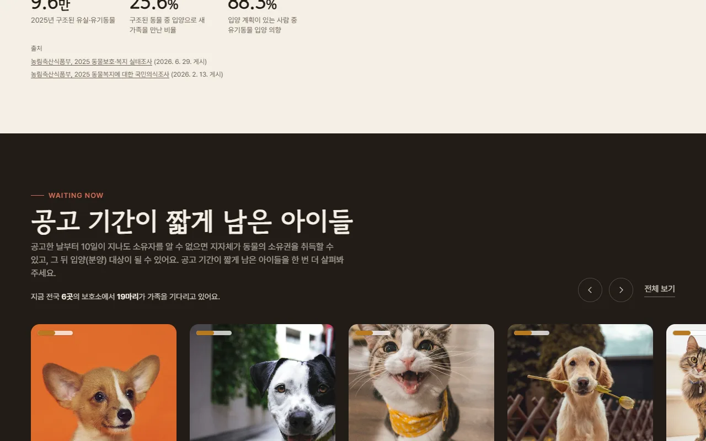

# 62댕냥 · 유기동물 입양·임시보호 정보 사이트

전국 보호소의 유기동물 공고를 공공데이터로 모아 보여 주고, 입양·임시보호·봉사·후원을 원하는 사람이 보호소에 바로 연락할 수 있도록 돕는 정적 웹사이트입니다. 서버와 데이터베이스 없이 GitHub Pages로 게시합니다: https://hayohio-bit.github.io/62dn/
신청과 예약은 보호소와 전화로 진행하며, 이 서비스는 동물과 보호소 정보를 찾기 쉽게 정리하는 역할을 합니다.

## 화면 구성

| 랜딩 | 공고 기간이 짧게 남은 아이들 |
| --- | --- |
|  |  |

| 입양 가능한 동물 목록 | 동물 상세 |
| --- | --- |
|  |  |

| 보호소 페이지 | 봉사·기부 안내 (보호소 검색) |
| --- | --- |
|  |  |

| 모바일 |
| --- |
|  |

> 스크린샷은 데모 데이터로 찍었습니다. 동물 사진은 Unsplash 이미지입니다. 회원가입·로그인·게시판·관리자 화면은 정적 버전 전환으로 없어졌습니다. 서버가 있던 이전 버전은 `legacy/spring-backend` 브랜치에 보관되어 있습니다.

## 주요 기능

- 유기동물 목록: 종류·크기·성별·시/도 필터와 이름·품종·보호소 검색, 공고 기간이 짧게 남은 순·새로 들어온 순 정렬, 공고 기간이 줄어드는 막대 표시(숫자 없이)
- 동물 상세: 보호소·담당자 연락처, 지도, 입양·임시보호 절차 안내, 공유하기, 같은 보호소의 다른 아이들
- 보호소 페이지: 보호소 연락처·길찾기와 그 보호소에서 공고 중인 동물 목록
- 최근 본 아이들: 로그인 없이 브라우저에 기록해 목록 상단에 표시
- 나를 위한 추천: 이 브라우저에 저장한 선호 조건(종류, 나이, 크기, 지역)에 맞는 동물을 최근 등록순으로 추천
- 관심 동물: 로그인 없이 하트로 저장하고 "관심 동물" 화면에서 모아 보기. 관심 동물과 선호 조건은 브라우저(localStorage)에 저장되어 기기마다 따로입니다
- 랜딩: 종류·지역 빠른 찾기, 실시간 현황(공고 중인 동물 수, 일주일 안에 공고가 끝나는 동물 수, 보호소 수), 농림축산식품부 「2025 동물보호·복지 실태조사」(2026. 6. 29. 게시)와 「2025 동물복지에 대한 국민의식조사」(2026. 2. 13. 게시) 통계(원문 링크 표기, 2026. 10. 31. 원문과 대조)
- 공공데이터 표시 원칙: 공고에 없는 이름은 "임시 이름"으로, 체중으로 추정한 크기는 "(추정)"으로, 확인되지 않은 중성화는 "보호소 확인 필요"로 표시
- 봉사·기부 안내: 보호소 검색과 전화 연결 안내
- 개인정보 처리방침·이용 안내: 브라우저 저장 정보, 접속 때 연결되는 외부 서비스, 데이터 출처와 한계를 코드와 맞춰 안내 (`privacyFacts.test.ts`가 저장 키·쿠키·외부 도메인과 문서가 어긋나지 않는지 점검)

## 기술 스택

| 영역 | 사용 기술 |
| --- | --- |
| Frontend | React 18, TypeScript, Vite 5, TailwindCSS, React Router, Framer Motion |
| 데이터 | 공공데이터포털 농림축산식품부 구조동물 조회 API를 빌드 때 받아 만든 JSON 스냅샷 (`frontend/public/data/snapshot.json`) |
| 외부 연동 | 카카오 지도(선택), Google Fonts, jsDelivr |
| 테스트 | Vitest, ESLint, `tsc` |
| 인프라 | GitHub Pages, GitHub Actions |

## 빠른 시작

요구사항: Node.js 20 이상. 사이트는 `public/data/snapshot.json`만 읽으며, 파일이 없으면 데모 데이터(보호소 6곳, 동물 20마리)를 만듭니다.

```bash
cd frontend
npm ci
npm run dev   # http://localhost:5173
```

## 데이터 스냅샷

사이트가 읽는 `frontend/public/data/snapshot.json`은 git에 넣지 않고 스크립트로 만듭니다.

```bash
cd frontend
npm run data:demo                     # 데모 데이터(보호소 6곳, 동물 20마리)로 스냅샷 생성
DATA_API_KEY=<서비스 키> npm run data:fetch   # 공공데이터 API에서 공고 중인 동물을 받아 생성 (--days N 으로 공고 시작일 범위 제한 가능)
npm test                              # 변환 규칙 테스트 (Vitest)
```

`npm run dev`와 `npm run build`는 스냅샷이 없을 때만 데모 스냅샷을 자동으로 만듭니다. 변환 규칙(털색·크기·나이·품종에 따른 임시 이름, 체중 기반 크기 추정, 마감 지난 공고 제외, 사진 주소 https 변환 등)은 `frontend/scripts/build-data/`에 있습니다.

## GitHub Pages 게시

`.github/workflows/pages.yml`이 매일 03:20(KST)에 공공데이터를 받아 스냅샷을 만들고, 테스트와 빌드를 거쳐 `https://hayohio-bit.github.io/62dn/`에 게시합니다. 빌드 결과는 하위 경로 `/62dn/` 기준이며, 새로고침 때 404가 나지 않도록 `404.html`(= `index.html`)을 함께 만듭니다. 다른 경로에 올릴 때는 `VITE_BASE`로 바꿉니다.

새 저장소에 게시할 때는 저장소 관리자가 한 번 설정해야 합니다. 설정을 마치기 전에는 예약 실행과 `main` push가 아무것도 하지 않습니다.

1. Settings → Pages → Build and deployment → Source를 "GitHub Actions"로 바꿉니다
2. Settings → Secrets and variables → Actions → Secrets에 `DATA_API_KEY`(공공데이터포털 서비스 키, 디코딩 값)를 등록합니다. 선택으로 카카오 지도 키 `VITE_KAKAO_MAP_KEY`도 등록합니다 (카카오 개발자 콘솔에서 허용 도메인에 `https://hayohio-bit.github.io`를 추가)
3. 같은 화면의 Variables에 `PAGES_ENABLED`를 `true`로 등록합니다
4. Actions 탭의 "Pages"에서 Run workflow로 첫 게시를 실행합니다 (수동 실행은 변수와 상관없이 됩니다)

키가 없거나 공공데이터에서 동물을 한 마리도 받지 못하면 워크플로가 실패하고 기존 사이트는 그대로 유지됩니다. 공개 저장소는 60일 동안 활동이 없으면 예약 실행이 꺼지므로, 오래 쉬었다면 수동 실행으로 다시 켭니다.

로컬에서 하위 경로 빌드를 확인하려면 `cd frontend && npm run build && npm run preview`를 실행하고 `http://localhost:4173/62dn/`을 엽니다.

## 프로젝트 구조

```
.
├── frontend/
│   ├── scripts/build-data/   공공데이터 → snapshot.json 변환 (이름 짓기, 크기 추정, 데모 데이터)
│   └── src/
│       ├── data/             스냅샷 로더, 목록 필터·정렬·추천·통계 계산
│       ├── lib/              브라우저 저장소(관심 동물·선호 조건·최근 본 동물), 공고 기간 계산
│       ├── components/       랜딩·목록·상세·정보 페이지 UI 컴포넌트
│       ├── pages/            라우트별 페이지
│       └── constants/        랜딩 문구, 통계 출처, 연락처
└── .github/workflows/        CI(린트·테스트·빌드), Pages 게시
```

## 테스트

```bash
cd frontend && npm run lint && npm test && npm run build
```

## 라이선스

[MIT License](LICENSE)
