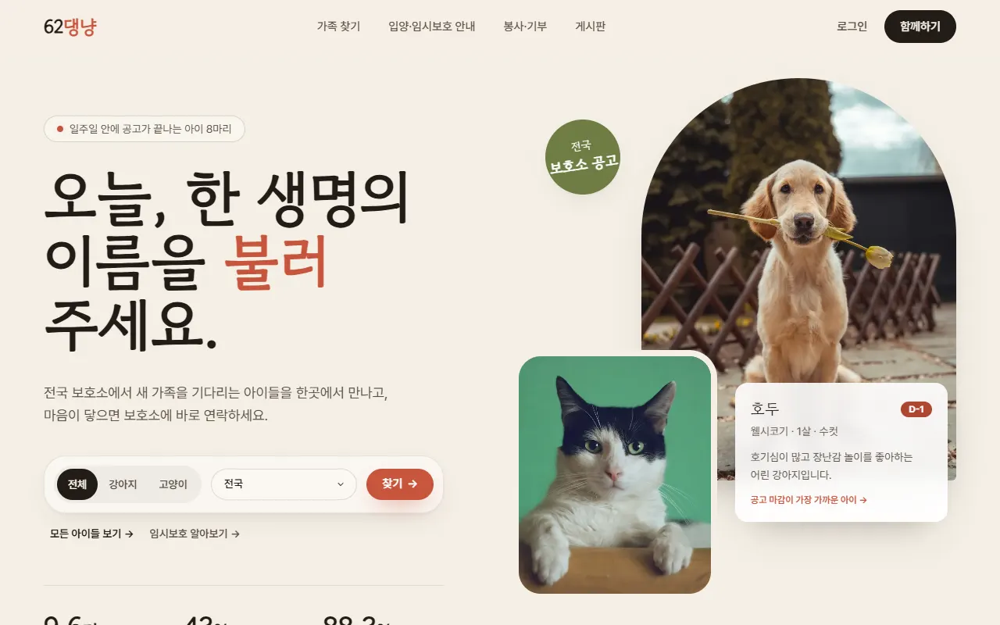
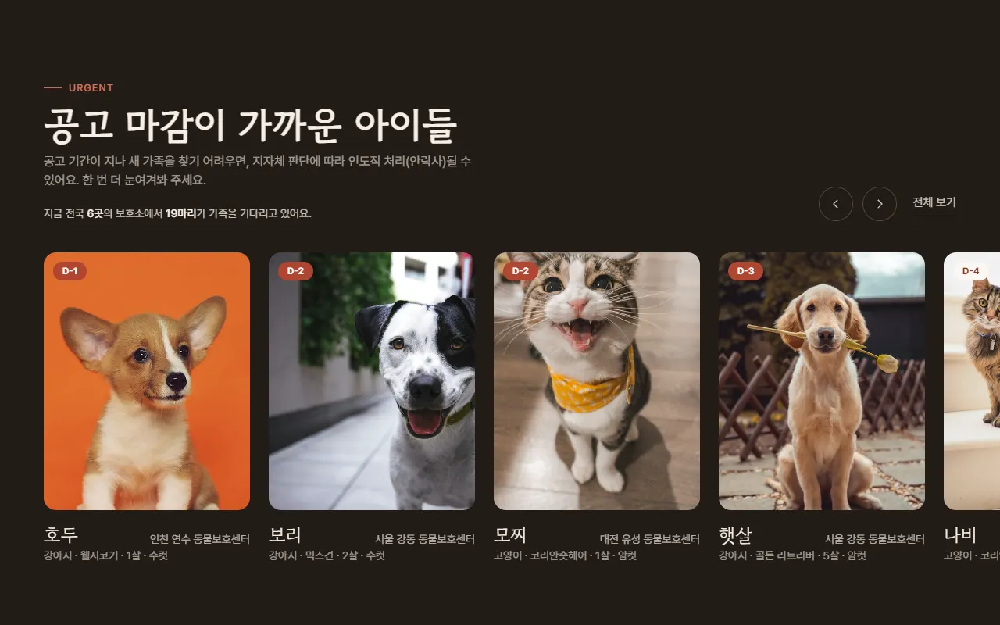
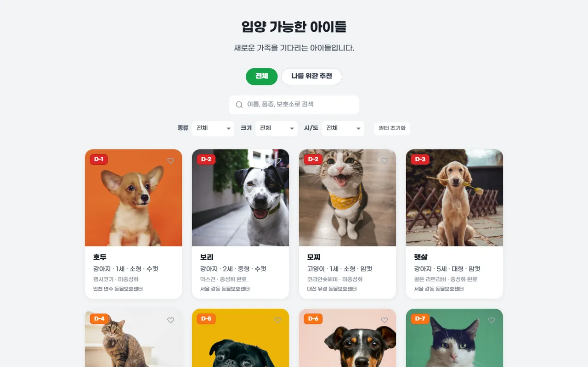
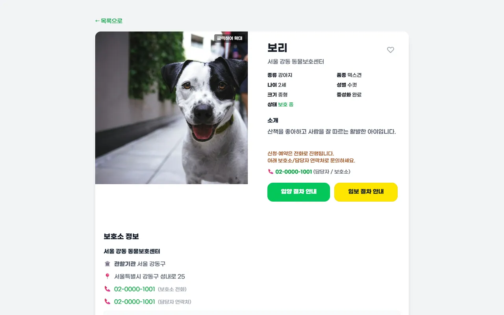
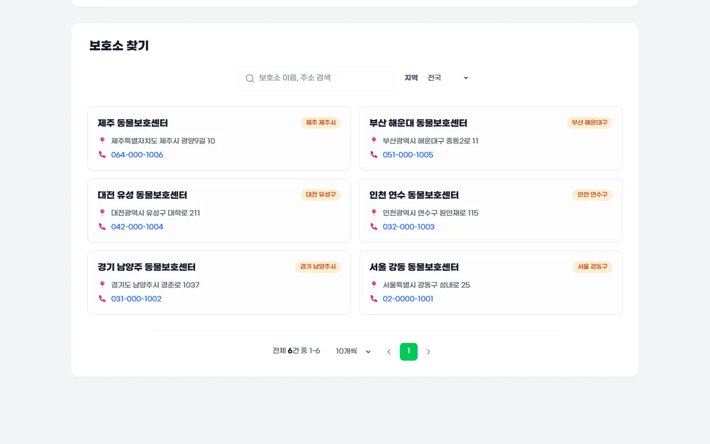
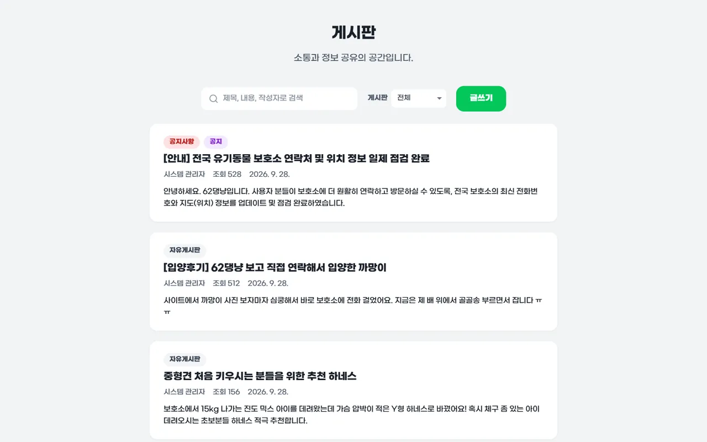
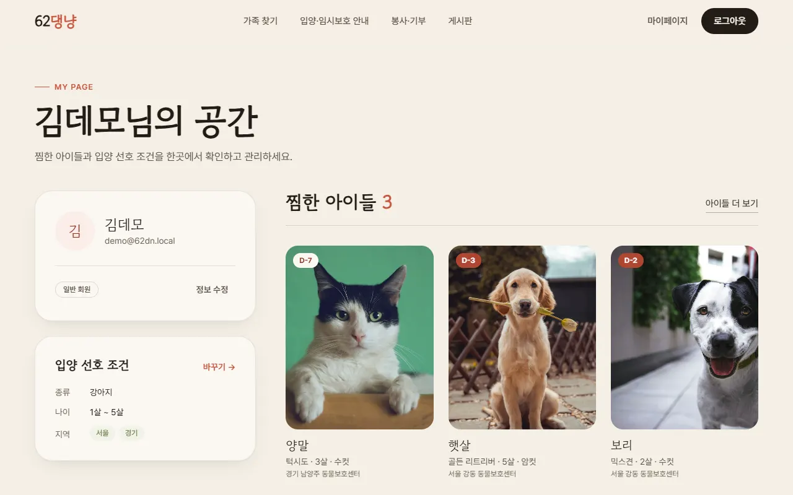
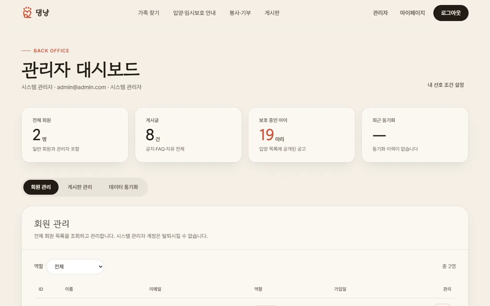

# 62댕냥 · 유기동물 입양/임시보호 매칭 플랫폼

전국 보호소의 유기동물 공고를 공공데이터로 모아 보여 주고, 입양·임시보호·봉사·후원을 원하는 사람이 보호소에 바로 연락할 수 있도록 돕는 웹 서비스입니다.
신청과 예약은 보호소와 전화로 진행하며, 이 서비스는 동물과 보호소 정보를 찾기 쉽게 정리하는 역할을 합니다.

## 화면 구성

| 랜딩 | 가족을 기다리는 아이들 (공고 마감 임박순) |
| --- | --- |
|  |  |

| 입양 가능한 동물 목록 | 동물 상세 |
| --- | --- |
|  |  |

| 봉사·기부 안내 (보호소 검색) | 게시판 |
| --- | --- |
|  |  |

| 마이페이지 | 관리자 대시보드 |
| --- | --- |
|  |  |

| 모바일 |
| --- |
|  |

> 스크린샷은 `local` 프로필의 데모 데이터로 찍었습니다. 동물 사진은 Unsplash 이미지입니다.

## 주요 기능

- 유기동물 목록: 종류·크기·시/도 필터와 이름·품종·보호소 검색, 공고 마감일(D-day) 표시
- 동물 상세: 보호소·담당자 연락처, 지도, 입양·임보 절차 안내
- 나를 위한 추천: 회원이 저장한 선호 조건(종류, 나이, 크기, 지역)에 맞는 동물 추천
- 관심 동물(찜) 저장
- 봉사·기부 안내: 보호소 검색과 전화 연결 안내
- 게시판: 공지사항·FAQ·자유게시판, 댓글
- 회원: 이메일 가입·로그인, 카카오·구글 로그인, 이메일 찾기
- 관리자: 회원 관리, 게시글 고정·삭제, 공공데이터 수동 동기화와 동기화 이력

## 기술 스택

| 영역 | 사용 기술 |
| --- | --- |
| Frontend | React 18, TypeScript, Vite 5, TailwindCSS, TanStack Query, Zustand, Axios, Framer Motion |
| Backend | Java 21, Spring Boot 3.2, Spring Security + JWT, Spring Data JPA, Flyway, springdoc-openapi |
| DB | MySQL 8 (운영·개발), H2 인메모리 (`local` 데모 프로필) |
| 외부 연동 | 공공데이터포털 농림축산식품부 구조동물 조회 API, 카카오 지도, 카카오·구글 OAuth |
| 인프라 | AWS EC2 + RDS, Nginx, GitHub Actions, Terraform |

## 빠른 시작 (MySQL 없이 데모 실행)

요구사항: Java 21, Node.js 20 이상

```bash
# 1) 백엔드: H2 인메모리 DB와 데모 데이터로 실행 (http://localhost:8080)
cd backend
./gradlew bootRun --args='--spring.profiles.active=local'

# 2) 프론트엔드: 다른 터미널에서 실행 (http://localhost:5173, /api 요청은 8080으로 프록시)
cd frontend
npm ci
npm run dev
```

`local` 프로필은 기동할 때마다 DB를 새로 만들고 보호소 6곳, 동물 20마리, 게시글과 댓글을 넣습니다.

| 계정 | 이메일 | 비밀번호 |
| --- | --- | --- |
| 데모 회원 | `demo@62dn.local` | `demo1234!` |
| 관리자 | `admin@admin.com` | `1234` |

공공데이터 동기화까지 시험하려면 `backend/.env`에 `DATA_API_KEY`(공공데이터포털에서 발급한 인코딩 키)를 넣고, 관리자 대시보드의 "API 수동 동기화" 탭에서 실행합니다.

## 개발 환경 (MySQL)

1. MySQL 8에 `dn_platform` 데이터베이스를 만듭니다. `dev` 프로필은 `ddl-auto: update`로 테이블을 자동 생성합니다.
2. `backend/.env.example`을 `backend/.env`로 복사해 DB 계정과 API 키를 채웁니다.
3. `cd backend && ./gradlew bootRun` (기본 프로필 `dev`)
4. `frontend/.env.example`을 `frontend/.env`로 복사해 카카오 지도·OAuth 키를 채운 뒤 `npm run dev`

API 문서는 백엔드 실행 후 http://localhost:8080/swagger-ui.html 에서 볼 수 있습니다.

## 운영 환경 변수

운영(`prod`) 프로필에는 기본값이 없어서 아래 값을 반드시 설정해야 합니다.

| 변수 | 설명 |
| --- | --- |
| `JWT_SECRET` | JWT 서명 키 (32바이트 이상 무작위 문자열). 없으면 서버가 기동하지 않습니다 |
| `DB_URL`, `DB_USERNAME`, `DB_PASSWORD` | MySQL 접속 정보 |
| `DATA_API_KEY` | 공공데이터포털 서비스 키 |
| `ADMIN_BOOTSTRAP_EMAIL`, `ADMIN_BOOTSTRAP_PASSWORD` | 선택. 두 값이 모두 있고 해당 회원이 없을 때만 최초 관리자 계정을 만듭니다 |

## 프로젝트 구조

```
.
├── backend/                  Spring Boot API 서버
│   └── src/main/java/com/dnproject/platform/
│       ├── config/           보안·CORS·스케줄러·초기 데이터
│       ├── controller/       REST 컨트롤러
│       ├── domain/           JPA 엔티티, enum
│       ├── dto/              요청·응답 DTO, 공공 API 응답 모델
│       ├── mapper/           엔티티 → 응답 변환
│       ├── repository/       Spring Data JPA 리포지토리
│       ├── security/         JWT 필터·발급
│       └── service/          비즈니스 로직, 공공데이터 동기화
├── frontend/                 React SPA
│   └── src/
│       ├── api/              API 모듈
│       ├── components/       랜딩·목록·관리자 등 UI 컴포넌트
│       ├── pages/            라우트별 페이지
│       ├── store/            Zustand 인증 스토어
│       └── types/            DTO·엔티티 타입
├── terraform/                AWS 인프라 정의
└── .github/workflows/        CI, EC2 배포
```

## 테스트

```bash
cd backend && ./gradlew build          # 단위 테스트 포함
cd frontend && npm run lint && npm run build
```

## 라이선스

[MIT License](LICENSE)
